# Speech Translator

A private Qoder Site for speech translation with two modes:

- **One-shot** (`/`) — record a phrase, get a transcript, a written translation
  and spoken audio.
- **Live interpreter** (`/realtime.html`) — speak continuously; each short pause
  produces a translated spoken phrase with a caption.

The browser talks only to the site's own Deno Edge Function at
`/functions/v1/app`. The function holds the service key and relays to Alibaba
Cloud Model Studio.

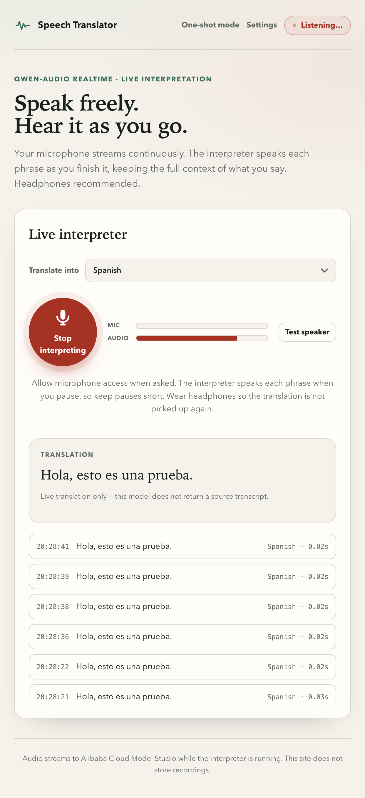

*The live interpreter running against the local preview server and its mock
relay. The deployed site streams from Alibaba Cloud Model Studio instead.*

## What it does

The app turns spoken phrases into another language and speaks the result back.
The one-shot page handles a single phrase and returns three artifacts — the
source transcription, the translated text and synthesized speech — with the
measured ASR, translation and speech latency shown per stage. The live
interpreter keeps the microphone open instead: it detects the end of each
phrase, translates it with the surrounding context, captions it and plays the
translation while the next phrase is being spoken, so a conversation continues
without a stop button. When the translated audio outlasts the source phrase,
playback trims quiet lead-in, drops silent padding and briefly speeds up so it
keeps up with a normal speaking pace.

Both pages translate into English, Mandarin Chinese, Spanish, Japanese, French,
Korean or German. The service key is configured once: a site Secret when one is
set, otherwise a key saved through the top-nav **Settings** dialog. That key
lives in an HttpOnly, SameSite=Strict cookie scoped to the function path, never
in published files or localStorage. The Settings dialog reports whether the
stored key belongs to the workspace the realtime host expects, so a mismatched
key family is caught before a session starts. Audio is sent to Alibaba Cloud
Model Studio for processing; the site does not store recordings.

The site is invite-only (Qoder sign-in) and is served as static files plus one
Edge Function, so no long-running server or WebSocket infrastructure is
deployed.

## Architecture

### System context

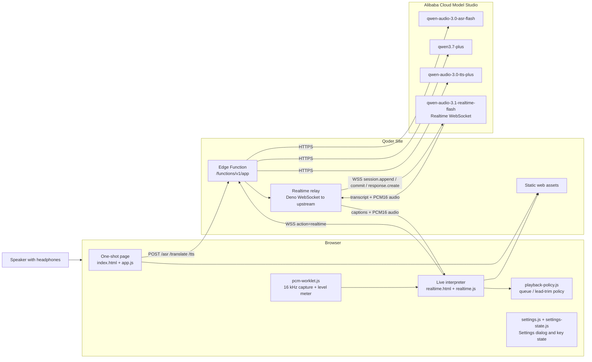

The model names above are fixed in source. The browser cannot select a different
upstream host or model.

### Components

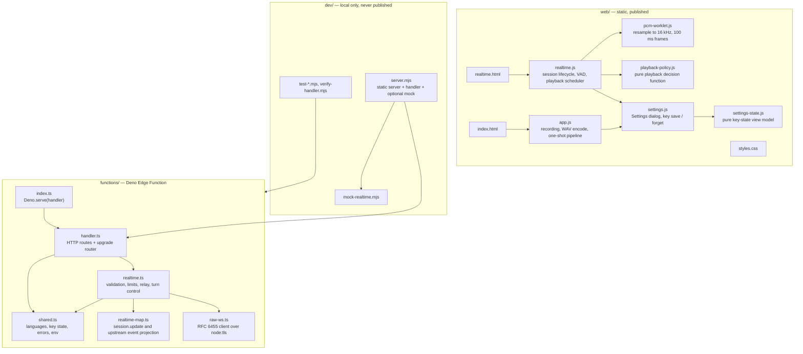

### Deployment topology

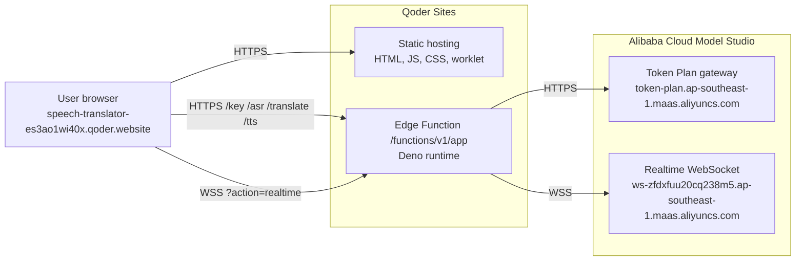

The realtime relay uses a dedicated WebSocket host; the one-shot pipeline uses the
Token Plan gateway. Both are constants in `functions/`.

### Live client states

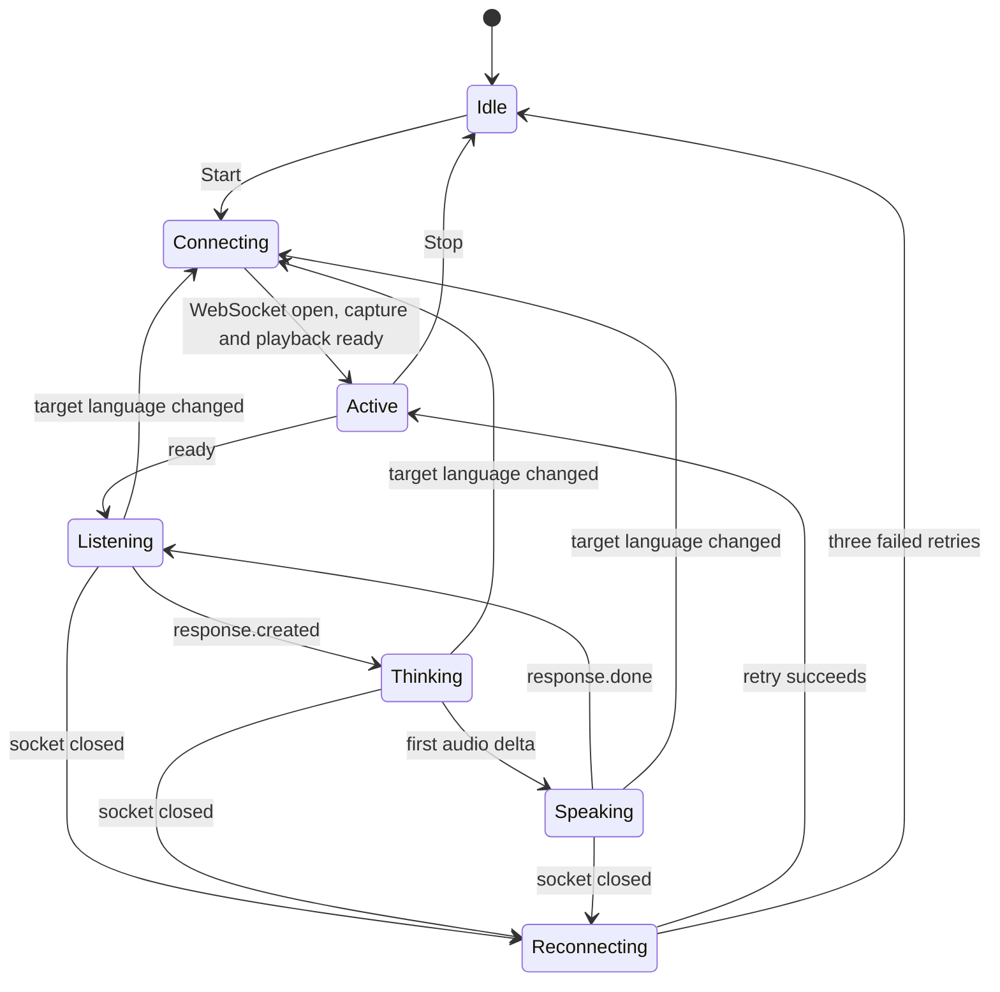

- `Connecting` covers microphone permission, AudioContext resume, worklet load and
  the WebSocket handshake.
- `Reconnecting` retries after 1 s, 2 s and 4 s, then stops with an error.
- A fatal server `error` frame stops the session immediately.
- A language change closes the socket, clears scheduled audio and reconnects with
  a new `target`.

### Relay states

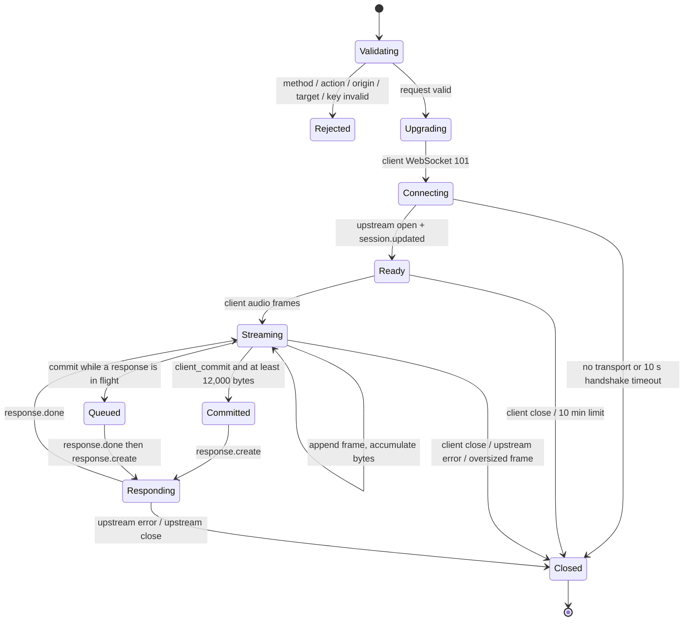

Only one `response.create` is in flight at a time. A commit received while the
model is still answering sets `pendingResponse`; the relay sends the next
`response.create` immediately after `response.done`, so a second phrase is queued
rather than lost.

## Call flows

### Page load and key state

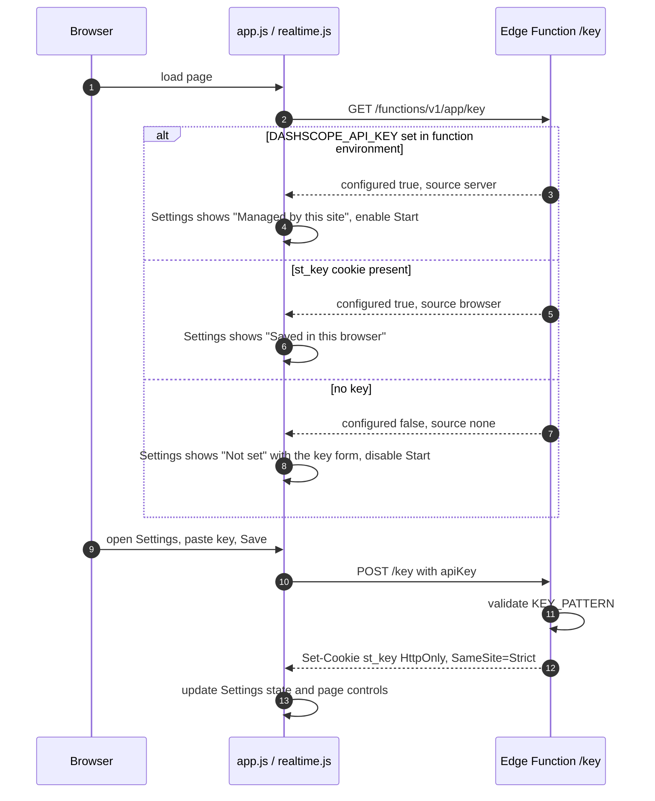

The key never reaches localStorage or page HTML. `DELETE /key` expires the cookie;
a server-side environment key remains in use.

### One-shot translation

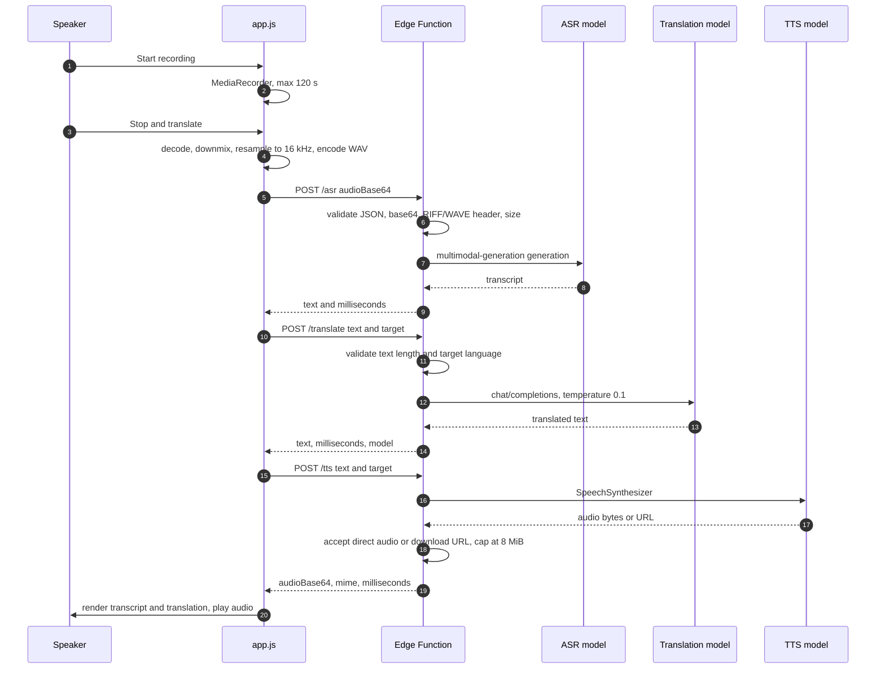

### Live session setup

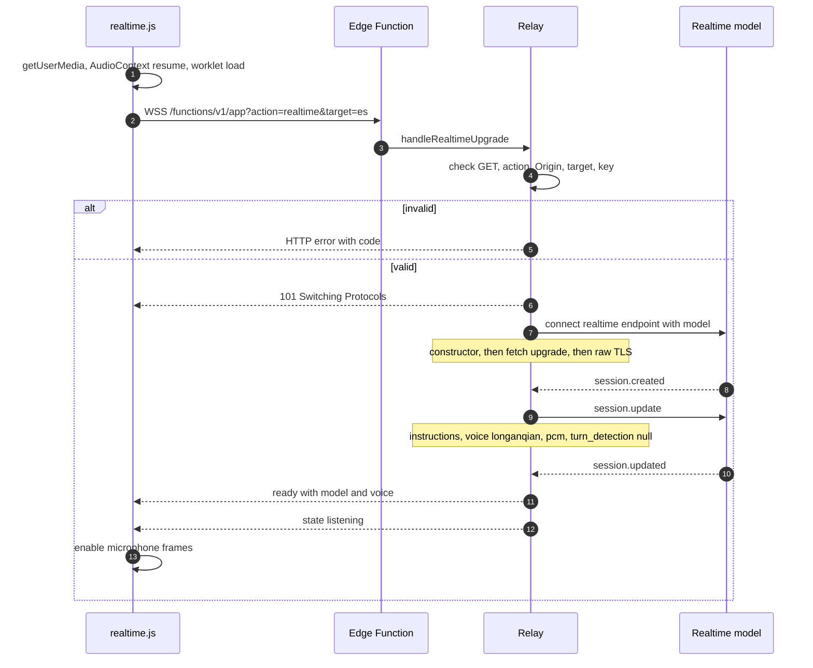

The client opens the socket only after capture and playback contexts are running.
The relay starts a 10 s handshake timer and a 10-minute session timer; the client
sends `keepalive` every 20 s.

### Live turn with manual VAD

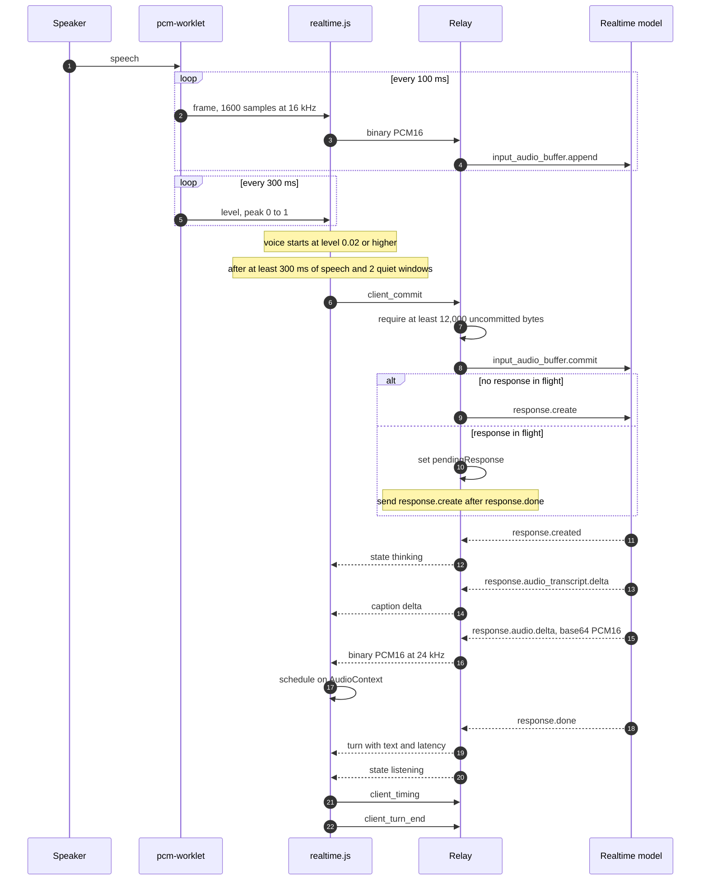

### Playback scheduling

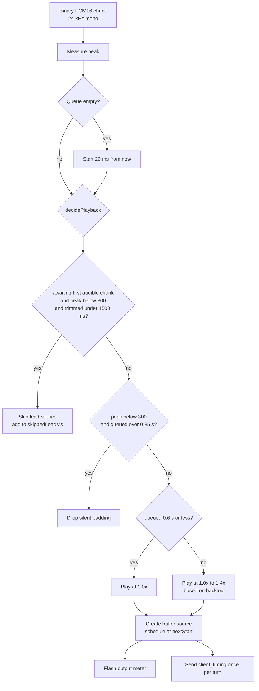

`web/playback-policy.js` is a pure function so the policy can be tested without a
browser. The scheduler keeps a monotonic `nextStart` in `AudioContext` time.

### Reconnect, language switch and stop

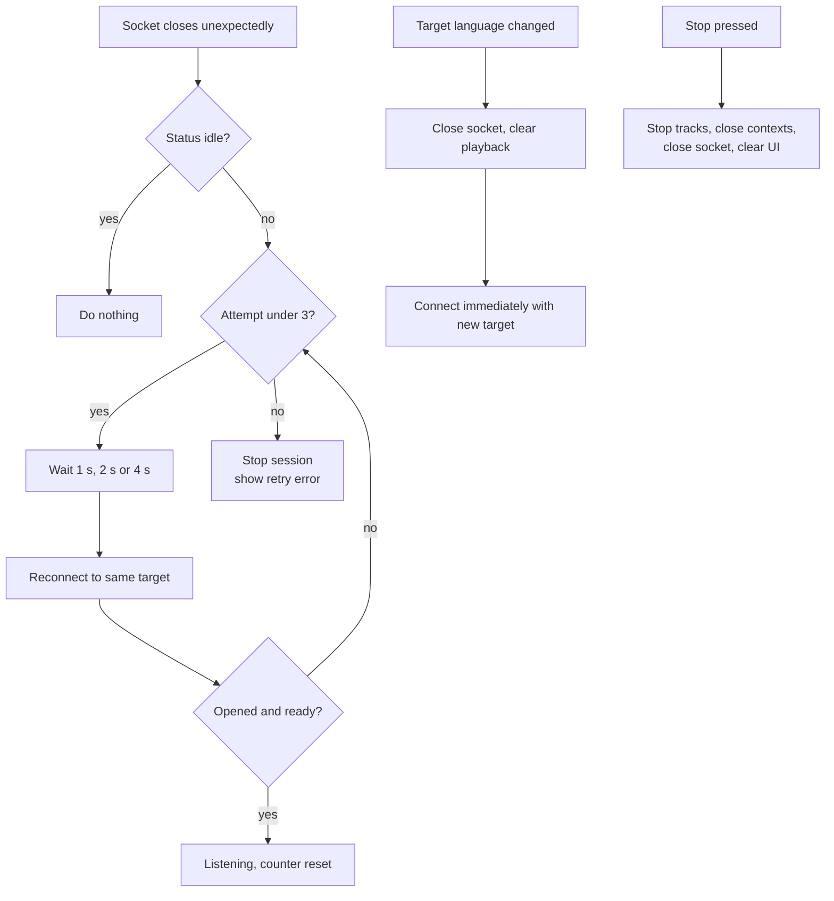

## Repository layout

| Path | Role |
| --- | --- |
| `web/` | Static pages, capture worklet, playback policy, Settings dialog, styles |
| `functions/` | Deno Edge Function: HTTP routes plus the realtime relay |
| `dev/` | Local preview server, mock realtime socket, tests |
| `docs/` | Detailed architecture and call-flow reference |

[docs/architecture.md](docs/architecture.md) adds file responsibilities, security
boundaries, limits, design decisions and observability.
[docs/call-flows.md](docs/call-flows.md) adds the WebSocket protocol tables,
latency budget, failure handling and verification commands.

## Local development

Requires Node.js 24+ (the dev server imports the TypeScript function directly).

```bash
cd speech-site
node dev/server.mjs
# http://127.0.0.1:4173/           one-shot page
# http://127.0.0.1:4173/realtime.html  live interpreter
```

The server loads `DASHSCOPE_API_KEY` from
`speech-translator/.streamlit/secrets.toml` without printing it. Useful
environment variables:

| Variable | Effect |
| --- | --- |
| `PORT` | Preview port, default `4173` |
| `SKIP_KEY_FILE` | Set to `1` to ignore the local secrets file |
| `MOCK_REALTIME` | Set to `1` to serve the mock live socket |
| `DASHSCOPE_API_KEY` | Use this key instead of the local secrets file |

The realtime pages require a secure context for microphone access. Use
`localhost`/`127.0.0.1`, or the deployed HTTPS site.

## Tests

```bash
node --test dev/test-realtime-map.mjs \
  dev/test-realtime-validate.mjs \
  dev/test-playback-policy.mjs \
  dev/test-raw-ws.mjs \
  dev/test-settings-state.mjs \
  dev/test-realtime-upstream.mjs \
  dev/test-auth-failure.mjs
```

These cover upstream event projection, upgrade validation, playback policy, the
raw RFC 6455 framing fallback, the Settings key-state view, upstream failure
classification and the key-rejection message shown in the browser. `dev/verify-handler.mjs` exercises the real
ASR → translation → TTS pipeline against a local WAV sample and a configured key.

## Configuration and secrets

- Never commit API keys, `.env` files or Streamlit secrets. `.env*` and
  `*.qoder.site` are already gitignored at the repository root.
- Server-side key: set `DASHSCOPE_API_KEY` in the Qoder Sites function
  environment / Sites Settings. The Settings dialog then reports the key as
  managed by the site and hides the form.
- Browser key: pasting a key in the Settings dialog posts it once to `/key`, which stores it
  in the HttpOnly `st_key` cookie (`Path=/functions/v1/app`,
  `SameSite=Strict`, `Secure` on HTTPS). It is never put in localStorage or the
  published JavaScript.
- Key family: one-shot mode accepts a Model Studio Token Plan key (`sk-sp`). The
  live interpreter must use a workspace key (`sk-ws`); the realtime host rejects
  Token Plan keys. `/key` reports the stored family, the Settings dialog states
  which key the page needs, and the live page refuses an `sk-sp` key before
  saving it. A Token Plan key saved earlier warns immediately on the live page,
  and an auth rejection names the family the relay actually sent.
- The site remains private. Publishing a new build does not change its audience.

## Deployment

The site is published from this directory through Qoder Sites. The local
`.Speech Translator.qoder.site` descriptor is created and updated by the Sites
tooling and is gitignored — do not commit or hand-edit it.

Before publishing, validate the static files and the function locally, then
prepare and publish through the Sites workflow.
# speed-translate
