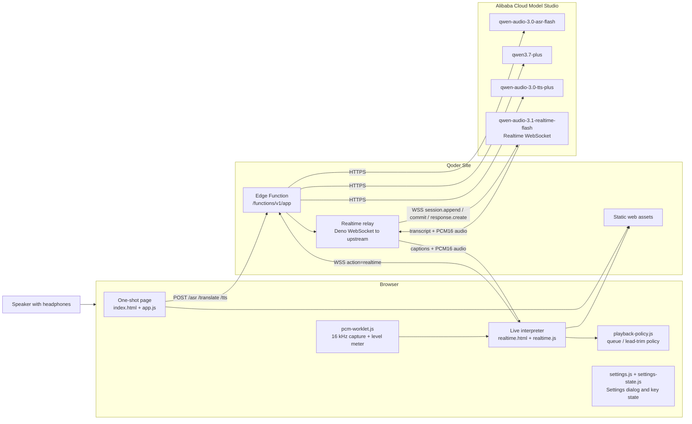
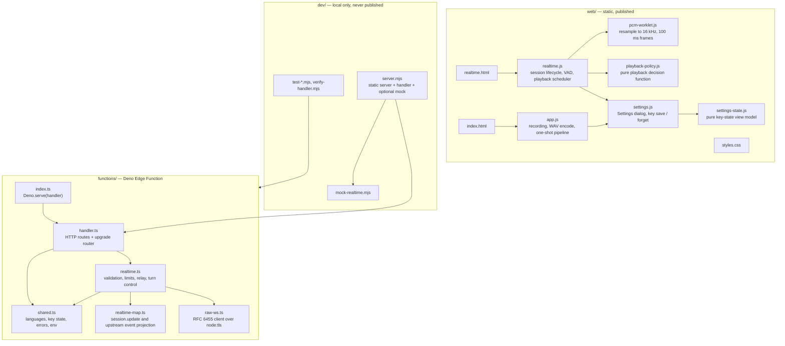
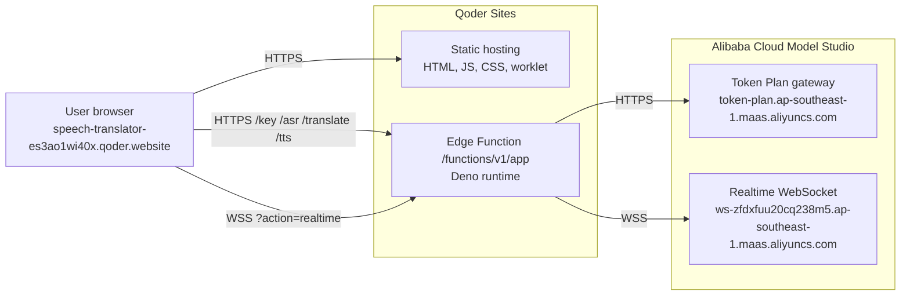
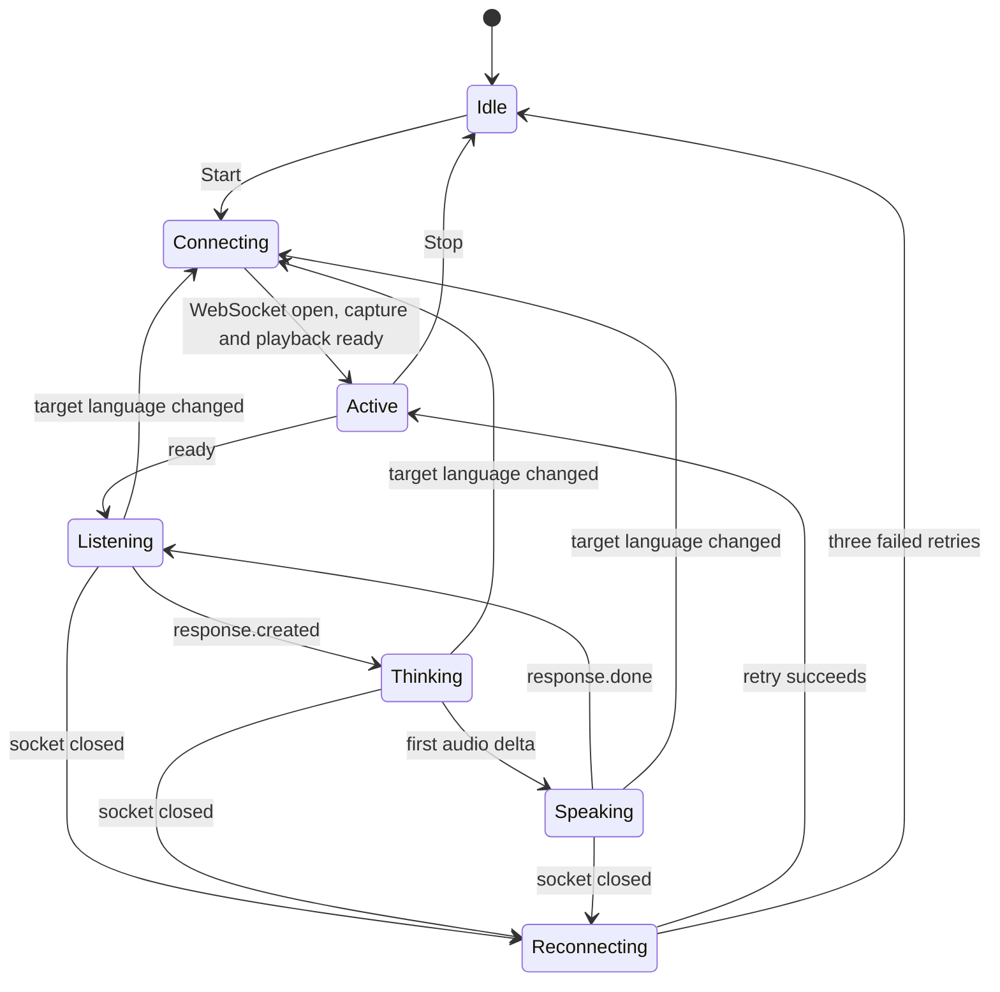
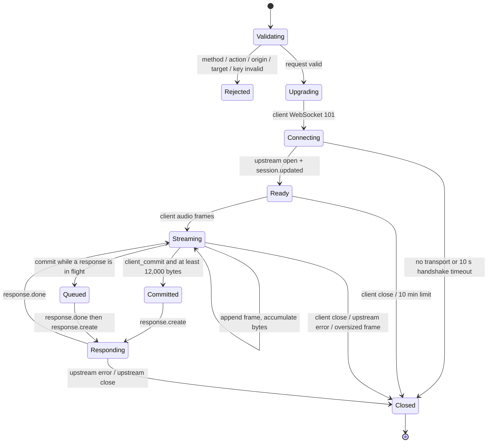

# Speech Translator — Architecture

A private Qoder Site that turns speech into translated speech. It offers two
modes:

| Mode | Page | Model path | Latency profile |
| --- | --- | --- | --- |
| One-shot | `/` (`index.html`) | ASR → LLM translation → TTS | Seconds per recording |
| Live interpreter | `/realtime.html` | Single realtime speech-to-speech model | ~1 s from pause to first translated audio |

Both modes share one same-origin Deno Edge Function at `/functions/v1/app`, so the
browser never calls Alibaba Cloud directly and never stores a service key in
page source.

## System context

The model names above are fixed in source. The browser cannot select a different
upstream host or model.

## Components

### File responsibilities

| File | Responsibility |
| --- | --- |
| `web/index.html`, `web/app.js` | One-shot record → transcribe → translate → speak flow |
| `web/realtime.html`, `web/realtime.js` | Live session, microphone capture, caption rendering, playback scheduling |
| `web/pcm-worklet.js` | AudioWorklet: linear resample to 16 kHz mono PCM16, 1600-sample (100 ms) frames, peak level every 3 frames |
| `web/playback-policy.js` | Pure decision function for lead-silence trim, silence drop and catch-up rate |
| `web/settings.js`, `web/settings-state.js` | Shared Settings dialog in the top navigation; reads and writes the key through `/key`, with a pure view model for the three key states |
| `web/styles.css` | Shared visual system and live meters |
| `functions/index.ts` | `Deno.serve(handler)` entry point |
| `functions/handler.ts` | HTTP routing, input validation, upstream calls for ASR/translation/TTS, key endpoint |
| `functions/shared.ts` | Supported languages, key cookie and env precedence, JSON/error helpers |
| `functions/realtime.ts` | WebSocket upgrade validation, origin allowlist, limits, relay, commit/response control, metrics |
| `functions/realtime-map.ts` | Builds `session.update`; projects upstream events into client frames |
| `functions/raw-ws.ts` | Minimal RFC 6455 client used when the Deno runtime cannot attach headers to an outbound WebSocket |
| `dev/server.mjs` | Local preview on port 4173, proxies `/functions/v1/app` to the handler |
| `dev/verify-handler.mjs` | Direct handler pipeline check against a local WAV sample |
| `dev/test-*.mjs` | Unit tests for event projection, request validation, playback policy and raw WebSocket framing |

## Deployment topology

The realtime relay uses a dedicated WebSocket host; the one-shot pipeline uses the
Token Plan gateway. Both are constants in `functions/`.

## Client state machine (live mode)

- `Connecting` covers microphone permission, AudioContext resume, worklet load and
  the WebSocket handshake.
- `Reconnecting` retries after 1 s, 2 s and 4 s, then stops with an error.
- A fatal server `error` frame stops the session immediately.
- A language change closes the socket, clears scheduled audio and reconnects to the
  same function with a new `target`.

## Relay state machine

Only one `response.create` is in flight at a time. A commit received while the
model is still answering sets `pendingResponse`; the relay sends the next
`response.create` immediately after `response.done`. This keeps a second phrase
from being lost without interrupting the phrase already being spoken.

## Security boundaries

| Boundary | Control |
| --- | --- |
| Browser → function | Same site; realtime upgrade requires a matching `Origin` against the site host allowlist and the request `Host` |
| Service key at rest | `DASHSCOPE_API_KEY` in the function environment, or HttpOnly cookie `st_key` (`Path=/functions/v1/app`, `SameSite=Strict`, `Secure` on HTTPS, 30-day max age) |
| Service key in the browser | Never placed in localStorage, page HTML or bundled JavaScript. The Settings dialog posts it once to `/key` |
| Upstream target | Gateway host, realtime host, model names and voice are constants; clients cannot pass a URL or model |
| Input validation | Method, `action`, target language, API key format, JSON body shape, text length, WAV RIFF header and audio size |
| Error output | Upstream status text and credentials are not forwarded; clients receive stable codes and user-safe messages |
| Resource limits | Frame, buffer, body and duration caps (see below) |
| Audience | The site is private; publication does not change access scope |

Key resolution order in `functions/shared.ts`:

1. `DASHSCOPE_API_KEY` from the function environment (`source: "server"`).
2. `st_key` cookie set through `POST /key` (`source: "browser"`).
3. Otherwise the request fails with `503 service_not_configured` (`source: "none"`).

The Settings dialog, opened from the top navigation, reports the resolved state:
`Managed by this site` hides the form, `Saved in this browser` allows replacing
or forgetting the cookie, and `Not set` asks for a key. When a server key exists,
the form is hidden and a browser cookie is ignored.

## Limits

| Limit | Value | Where |
| --- | --- | --- |
| HTTP request body | 6 MiB | `handler.ts` |
| WAV upload | 4 MiB | `handler.ts` |
| Text to translate | 4,000 characters | `handler.ts` |
| Text to speak | 2,000 characters | `handler.ts` |
| TTS audio download | 8 MiB | `handler.ts` |
| ASR timeout | 60 s | `handler.ts` |
| Translation timeout | 30 s | `handler.ts` |
| TTS timeout | 60 s | `handler.ts` |
| TTS download timeout | 30 s | `handler.ts` |
| Live client frame | 2 MiB | `realtime.ts` |
| Live upstream event | 256 KiB | `realtime.ts` |
| Relay output buffer | 1 MiB | `realtime.ts` |
| Upstream handshake | 10 s | `realtime.ts` |
| Live session | 10 min | `realtime.ts` |
| Minimum commit audio | 12,000 bytes (375 ms @ 16 kHz PCM16) | `realtime.ts` |
| Client keepalive | 20 s | `realtime.js` |
| Reconnect delays | 1 s, 2 s, 4 s | `realtime.js` |

## Design decisions

### Same-origin relay instead of a direct browser connection

The browser connects to `/functions/v1/app?action=realtime` on the site's own
host. The function holds the service key, validates the origin and target, and
opens the upstream socket. This keeps the key out of the page and gives one place
to enforce limits and sanitize errors.

### Manual turn detection instead of server VAD

The session is configured with `turn_detection: null`. The client measures level
from the capture worklet and sends `client_commit` after a short pause; the relay
commits the buffered audio and asks for a response.

Both built-in VAD modes cancel an in-flight response as soon as the speaker
resumes, which discarded nearly every translation and left the page silent while
the source transcript streamed. `smart_turn_v2` also classified quiet speech as
ambient audio. Manual commits let a translation finish speaking even if the
speaker has already started the next phrase.

### Client-side playback scheduler

The model delivers audio faster than real time and often pads a response with
silence. `realtime.js` schedules PCM chunks on the `AudioContext` clock and uses
`playback-policy.js` to:

- skip quiet lead-in, capped at 1.5 s;
- drop silent padding once more than 0.35 s is already queued;
- play a queued response up to 1.4× speed when the backlog exceeds 0.6 s.

This keeps the audible translation under the 2 s budget without dropping audible
content.

### Transport fallback for the upstream socket

Some Deno runtimes cannot attach an `Authorization` header to an outbound
`WebSocket` constructor. The relay tries, in order: the constructor with headers,
a `fetch` upgrade, then a minimal RFC 6455 client over `node:tls`
(`raw-ws.ts`). The first transport that opens is used for the session.

## Observability

The relay and client emit structured events that can be read from function logs:

| Event | Meaning |
| --- | --- |
| `realtime_enter`, `realtime_rejected` | Upgrade attempt and validation result |
| `realtime_upstream_connected` | Which transport opened (`constructor`, `fetch`, `raw_tls`) |
| `realtime_upstream_event` | First occurrence of each upstream event type |
| `realtime_client_commit` | Committed byte count for a turn |
| `realtime_queued_response_create` | A response was deferred until the active one finished |
| `realtime_turn_summary` | Per-response status, audio duration, first text and first audio latency |
| `realtime_relay_summary` | Event types, client/upstream/relay frame and byte counters |
| `realtime_client_timing` | Audible latency, queue delay, lead trim, peak level, device latency, playback rate |
| `realtime_client_turn_end` | Audio still queued when a turn ended |
| `realtime_client_error_report` | Browser-reported playback error |

The log stream never includes the service key or raw upstream error bodies.

## Related documents

- [Call flows](call-flows.md) — sequence diagrams and protocol tables.
- [README](../README.md) — local development and verification commands.
