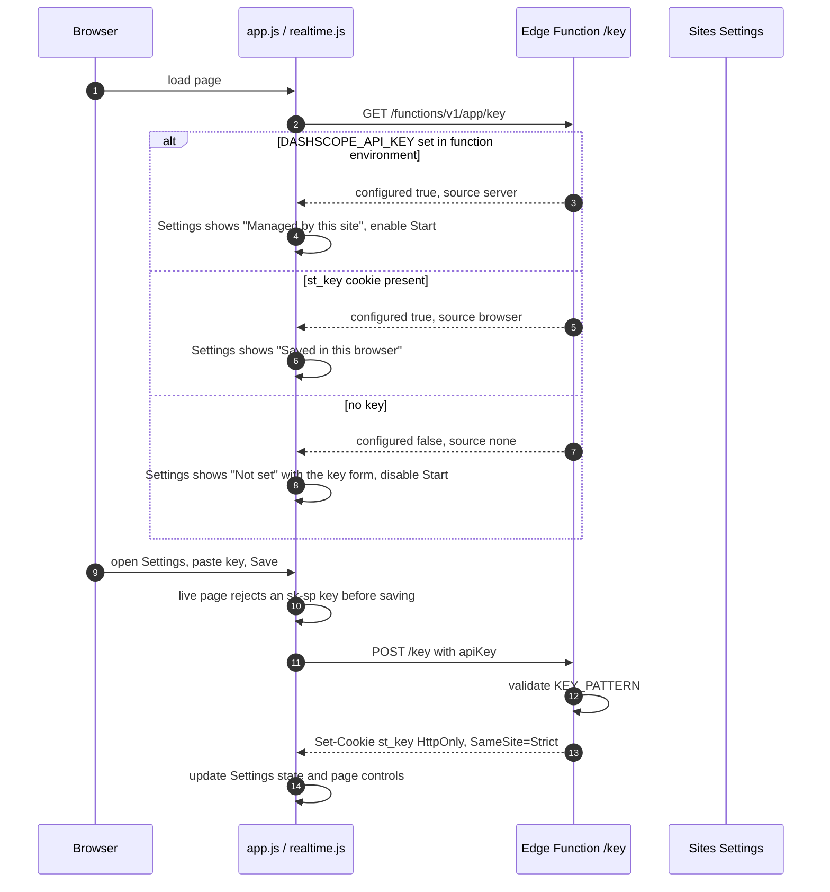
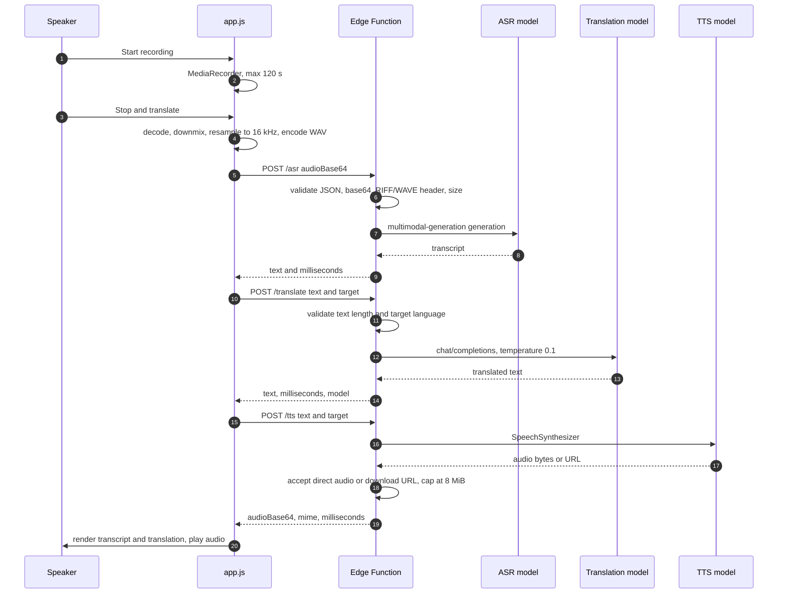
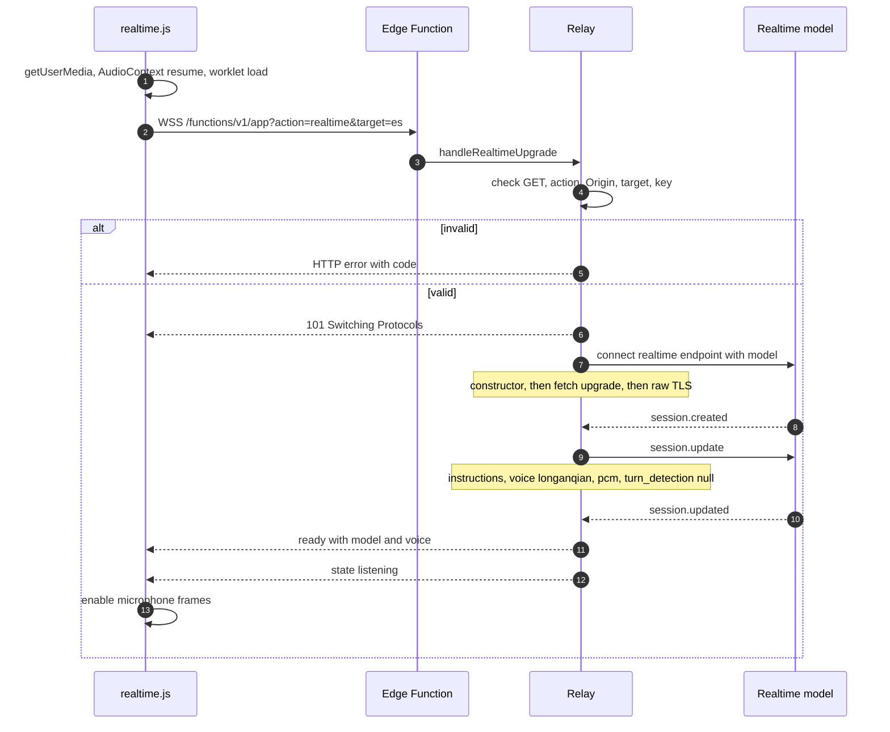
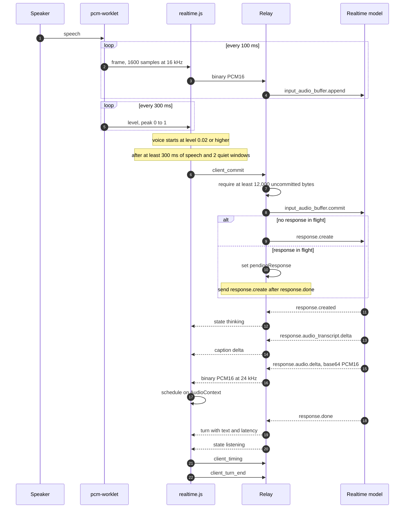
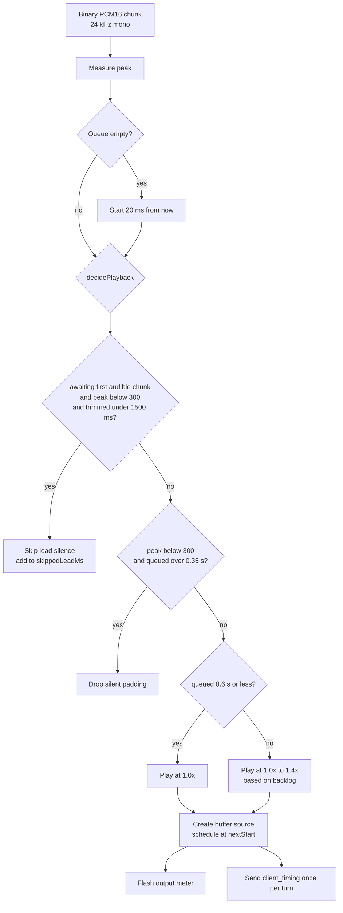
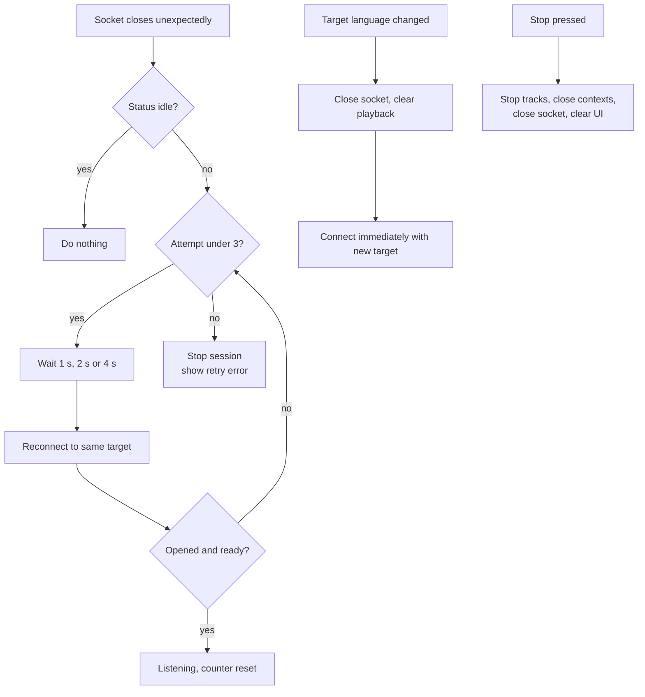

# Speech Translator — Call Flows

Sequence-level reference for both modes. All browser traffic is same-origin under
`/functions/v1/app`; the function is the only component that talks to Alibaba
Cloud.

- [1. Page load and key state](#1-page-load-and-key-state)
- [2. One-shot translation](#2-one-shot-translation)
- [3. Live session setup](#3-live-session-setup)
- [4. Live turn with manual VAD](#4-live-turn-with-manual-vad)
- [5. Playback scheduling](#5-playback-scheduling)
- [6. Reconnect, language switch and stop](#6-reconnect-language-switch-and-stop)
- [7. WebSocket protocol reference](#7-websocket-protocol-reference)
- [8. Latency budget](#8-latency-budget)
- [9. Failure handling](#9-failure-handling)
- [10. Local verification](#10-local-verification)

## 1. Page load and key state



- `GET /key` reports `server`, `browser` or `none`, plus the stored key's family
  (`workspace`, `token_plan` or `other`) so the live page can flag a key the
  realtime host will refuse.
- `POST /key` validates the key format, then sets the cookie; the key is not
  echoed back.
- The live page additionally refuses a Token Plan (`sk-sp`) key in the browser
  before saving, because the realtime host only accepts workspace keys.
- `DELETE /key` expires the cookie. A server-side environment key remains in use.
- The key is never written to localStorage or page HTML.
- `S` (Sites Settings) is optional: a function Secret named `DASHSCOPE_API_KEY`
  upgrades every visitor to `source: "server"` and hides the key form in Settings.

## 2. One-shot translation



Request shapes:

```json
POST /asr        { "audioBase64": "<wav bytes as base64>" }
POST /translate  { "text": "<transcript>", "target": "es" }
POST /tts        { "text": "<translation>", "target": "es" }
```

- `target` must be one of `en`, `zh`, `es`, `ja`, `fr`, `ko`, `de`.
- The transcript is shown before the later stages run, so a slow TTS step does
  not hide the recognized text.
- The pipeline is sequential: ASR → translation → speech. Each stage reports its
  own duration in the UI.

## 3. Live session setup



- The client opens the socket only after microphone capture and playback contexts
  are running, so the first phrase cannot arrive before audio can be scheduled.
- The relay starts a 10 s handshake timer when the upstream connection begins and
  closes with `1011` if `session.updated` never arrives.
- The relay also starts a 10-minute session timer.
- The client sends `keepalive` every 20 s; the relay echoes it so intermediaries
  keep the connection open.

## 4. Live turn with manual VAD



Client VAD constants (`web/realtime.js`):

| Constant | Value | Effect |
| --- | --- | --- |
| `VOICE_LEVEL` | 0.02 | Peak above this counts as speech |
| `VAD_WINDOW_MS` | 300 | One level report covers three 100 ms frames |
| `VAD_MIN_SPEECH_MS` | 300 | Ignore coughs and clicks |
| `VAD_SILENCE_WINDOWS` | 2 | Commit after about 600 ms of quiet |

Relay turn constants (`functions/realtime.ts`):

| Constant | Value | Effect |
| --- | --- | --- |
| `MIN_COMMIT_BYTES` | 12,000 | 375 ms of 16 kHz mono PCM16; upstream rejects empty commits |
| `MAX_CLIENT_FRAME` | 2 MiB | Close `1009` above this |
| `MAX_BUFFERED` | 1 MiB | Skip audio frames when the client socket is backed up |

Ordering guarantees:

1. Audio frames sent before `client_commit` are appended before the commit.
2. A commit received while a response is active is not dropped. It sets
   `pendingResponse`, and the relay sends `response.create` immediately after the
   active `response.done`.
3. The model's `response.created` resets the per-turn transcript and latency
   counters, so a late event from an earlier turn cannot leak into the new one.

## 5. Playback scheduling



`web/playback-policy.js` is a pure function so the policy can be tested without a
browser. The scheduler keeps a monotonic `nextStart` in `AudioContext` time; each
chunk starts where the previous one ends.

Playback constants:

| Constant | Value | Purpose |
| --- | --- | --- |
| `OUTPUT_RATE` | 24,000 Hz | Model output rate |
| `SILENT_PEAK` | 300 | Absolute peak considered silence |
| `LEAD_TRIM_MAX_MS` | 1,500 | Maximum quiet lead-in removed |
| `SILENCE_KEEP_AHEAD` | 0.35 s | Queue depth above which silent padding is dropped |
| `CATCHUP_QUEUE` | 0.6 s | Backlog above which playback speeds up |
| `MAX_RATE` | 1.4x | Maximum catch-up rate |

Continuous speech produces about 1.3 s of translated audio per second of input
(measured: 6.3 s of speech produced 8.24 s of audio). The rate rises with the
backlog, never falls within a turn, and the cap sits above that ratio so a
growing queue always drains instead of compounding across turns.

If the browser blocks `AudioContext`, the client stops and asks the user to tap
Start again. The `Test speaker` button plays a short two-tone signal through a
fresh context and flashes the output meter; it does not use the network.

## 6. Reconnect, language switch and stop



- Reconnect reuses the same target and rebuilds the WebSocket only; microphone
  and playback contexts stay alive.
- A language switch clears scheduled audio before reconnecting, so the previous
  language cannot keep speaking.
- Stop stops every capture track, closes both AudioContexts, stops all scheduled
  sources and resets meters and captions.
- After three failed retries the page reports either "the service could not
  start" (never ready) or "the live connection dropped" (was ready before).

## 7. WebSocket protocol reference

### Browser → relay

| Frame | Fields | Purpose |
| --- | --- | --- |
| text `keepalive` | none | Sent every 20 s; relay echoes |
| text `client_commit` | none | Commit buffered audio and request a translation |
| text `playback_started` | none | First translated chunk was scheduled |
| text `client_timing` | `audibleMs`, `queuedMs`, `skippedLeadMs`, `captionToAudioMs`, `peak`, `baseLatencyMs`, `outputLatencyMs`, `rate` | Playback metrics |
| text `client_turn_end` | `remainingMs` | Audio still queued when the turn ended |
| text `client_error` | `detail` | Browser playback error; sanitized before logging |
| binary | PCM16 mono 16 kHz | Microphone audio |

### Relay → browser

| Frame | Fields | Purpose |
| --- | --- | --- |
| text `ready` | `model`, `voice` | Upstream session configured |
| text `state` | `listening`, `thinking`, `speaking` | Drive the status pill |
| text `caption` | `delta` | Translated transcript fragment |
| text `turn` | `text`, `firstAudioMs`, `turnMs` | Turn complete; add to history |
| text `error` | `code`, `message`, `fatal` | Sanitized error; fatal stops the session |
| binary | PCM16 mono 24 kHz | Translated speech |

### Relay → upstream

| Event | Fields | Purpose |
| --- | --- | --- |
| `session.update` | `instructions`, `modalities`, `voice`, `input_audio_format`, `output_audio_format`, `turn_detection: null` | Configure interpreter behavior |
| `input_audio_buffer.append` | `audio` (base64) | One microphone frame |
| `input_audio_buffer.commit` | none | End of a phrase |
| `response.create` | none | Ask for the translation |

### Upstream → relay (projected)

| Event | Client effect |
| --- | --- |
| `session.created` | Relay sends `session.update` |
| `session.updated` | `ready`, state `listening` |
| `response.created` | State `thinking`, reset turn counters |
| `response.audio_transcript.delta` | `caption` delta |
| `response.audio_transcript.done` | Fallback caption when no deltas were sent |
| `response.audio.delta` | State `speaking`, binary PCM to browser |
| `response.done` | `turn`, state `listening`, release queued response |
| `error` | Fatal sanitized error, close `1011` |

## 8. Latency budget

Measured on the direct upstream spike with the same session configuration:
`1.03 s` from commit to first audio delta, with `203,520` bytes of audio produced
for a two-sentence phrase.

| Stage | Typical cost | Notes |
| --- | --- | --- |
| Pause detection | ~600 ms | Two 300 ms quiet windows after speech |
| Commit + `response.create` relay hop | Network RTT | Same-region function to upstream |
| Model first audio | ~1.0 s | Measured after commit |
| Playback scheduling | 20 ms when idle | Or current queue depth when audio is still playing |
| Lead-silence trim | Saves up to 1.5 s | Removes quiet padding before the first word |

The target is under 2 s from pause to audible translation. The dominant risk is
queueing behind a previous translation; catch-up playback and silence dropping
keep that backlog bounded.

## 9. Failure handling

| Symptom | Code | Behavior |
| --- | --- | --- |
| No key configured | `503 service_not_configured` | Settings dialog opens; Start is disabled |
| Request from another origin | `403 forbidden_origin` | Upgrade rejected |
| Unsupported target | `400 invalid_target` | Upgrade or HTTP call rejected |
| Invalid key format | `400 invalid_key` | Key form shows the message |
| Upstream gateway rejects credentials | `502 upstream_auth` | One-shot calls; a live session closes as `1011 upstream_auth` and names the key family |
| Upstream rate limit | `429 upstream_busy` | Ask the user to wait and retry |
| ASR or TTS timeout | `504 upstream_timeout` | Ask for a shorter phrase or recording |
| Empty recognition | `422 no_speech` | Ask for a clearer, longer phrase |
| Upstream unreachable | `502 upstream_unreachable` | Retry message |
| No upstream transport | Close `1011 upstream_unavailable` | Client retries, then stops |
| Handshake timeout | Close `1011 upstream_timeout` | Client retries, then stops |
| Session over 10 min | Close `1000 time_limit` | Client reconnects if running |
| Oversized client frame | Close `1009 frame_too_large` | Session ends |
| Browser playback failure | `client_error`, then UI error | Ask the user to reload |
| Translation in flight when next phrase commits | none | `pendingResponse` queues the next response |

The relay never forwards raw upstream error text, request headers or the service
key. Client-reported details are stripped to printable ASCII and truncated before
logging.

## 10. Local verification

```bash
# Unit tests: event mapping, validation, playback policy, raw WebSocket framing,
# Settings state, upstream failure classification, key-rejection copy
node --test dev/test-realtime-map.mjs \
  dev/test-realtime-validate.mjs \
  dev/test-playback-policy.mjs \
  dev/test-raw-ws.mjs \
  dev/test-settings-state.mjs \
  dev/test-realtime-upstream.mjs \
  dev/test-auth-failure.mjs

# Local preview with the real function and a mock realtime socket
node dev/server.mjs
# open http://127.0.0.1:4173/ and /realtime.html

# Local preview against the real upstream (requires the local secrets file)
node dev/server.mjs

# Direct handler pipeline check with a WAV sample
SAMPLE_WAV=/path/to/sample.wav node dev/verify-handler.mjs
```

The local server reads `DASHSCOPE_API_KEY` from
`speech-translator/.streamlit/secrets.toml` without printing it. Set
`SKIP_KEY_FILE=1` to disable that and test the unconfigured state. Set
`MOCK_REALTIME=1` to attach the mock WebSocket used for UI testing.
